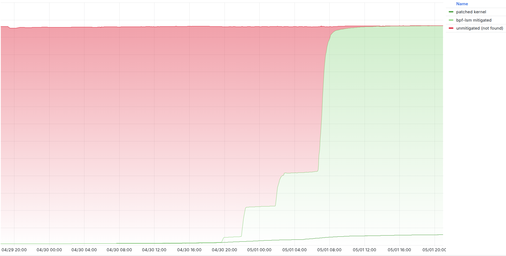
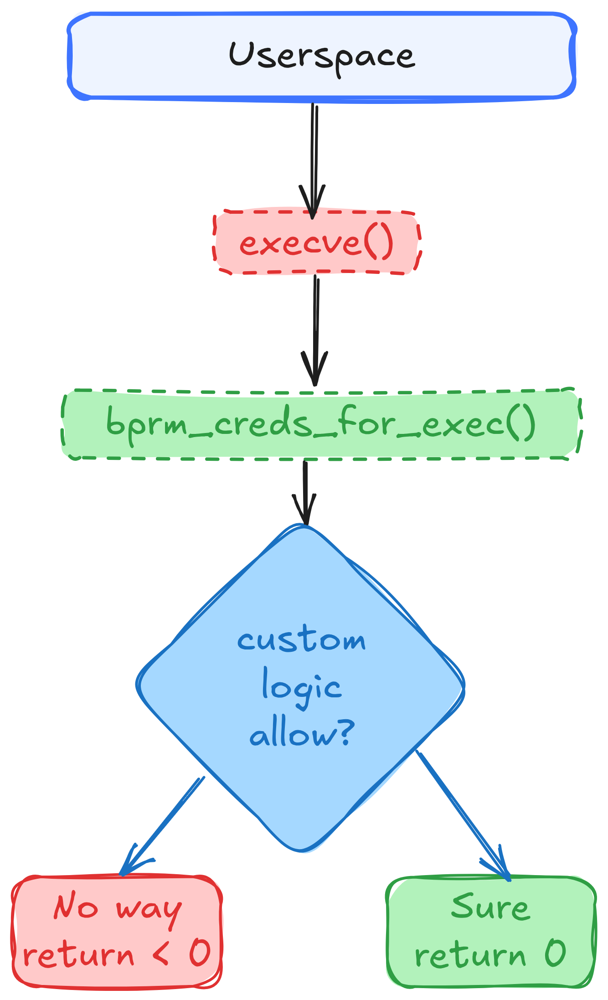
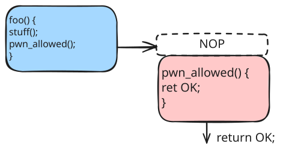
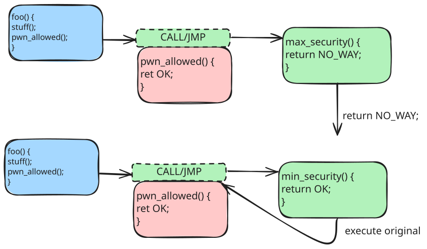
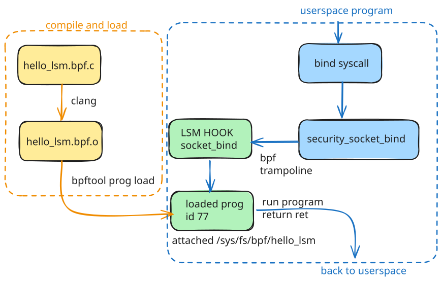
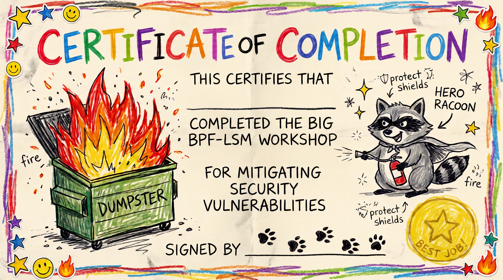

<!-- _class: title -->
<!-- _paginate: false -->


# Mitigating All The Vulns with BPF-LSM: A Tutorial

Chris Arges <carges@cloudflare.com>

---

## get the VM ready

1. Download the image from https://github.com/arges/bpf-lsm-workshop/
2. Instructions are in `docs/running.md`
3. Login: `workshop` / `workshop`
4. Be able to have multiple terminals

---
## prepare your workspace inside the VM

```sh
cd ~/bpf-lsm-workshop
make -C labs/tools
mkdir -p labs/work && cd $_
```
- ideally you can work interactively in `work`
- you can use `labs/0*` as checkpoints if you need to catch up

---


## Introduction

- **Who** Chris Arges, Principal Systems Engineer, Cloudflare, Linux Team
- Worked with Linux systems for over 20 years
- Contributed to Linux Kernel, Ubuntu, Debian, and more
- Interested in Linux, Security

---

## Cloudflare and our network

<div class="cf-network">
  <ul class="cf-network-text">
    <li>Linux across <strong>335+ cities</strong>, multiple datacenters, many servers</li>
    <li>Build our own latest <strong>longterm stable</strong> kernels; use Debian</li>
    <li>Continually update to the latest patch, update to next LTS every year</li>
    <li>Releases are done continuously, gradually, and slowly, many versions running at once</li>
  </ul>
  <figure class="cf-network-figure">
    
    <figcaption>Source: cloudflare.com/network</figcaption>
  </figure>
</div>

---

<!-- _class: lead -->

# why learn about this

---

<!-- _class: picture-side-by-side -->

## Linux Vulnerabilities


- LPE - Local Privilege Escalation
- RCE - Remote Code Execution
- Disclosure / Information Leak
- Container/Guest Escape
- DoS - Denial of Service
- Not getting pwned


<!--
- let's talk about Linux vulnerabilities.
- what do we mean by a vuln?
- ok, nothing here is new, but some things have changed
-->

---

<!-- _class: picture-side-by-side -->

## Hockey Stick Growth

![CVE fixes by dated Linux release][cve-fixes-timeline]

[cve-fixes-timeline]: images/cve-fixes-timeline.svg

- [Security in the LLM age](https://kernel-recipes.org/en/2026/security-in-the-llm-age/)
- Kernel.org became a CVE Numbering Authority Feb 2024 (around 6.8)
- Volume of CVEs has gone up
- Mean Time to Exploit: **Negative 7 Days**

<!--
- this graph shows Linux Kernel CVEs since kernel.org became a CNA
- interesting talks you can watch
- another interesting fact is that mean time to exploit has gone negative
- ok if MTTE is negative what can we actually do
-->

---

<!-- _class: table-dense -->

## Mitigation strategies

- **Update kernel and reboot** - Slow, can fix anything, _if_ a patch exists.
- **Disable module or feature** - Fast, only works if disabling is possible.
- **Firewalls** - Fast, if you can filter for malicious packets.
- **Kernel livepatch** - Fast, needs patch infrastructure, complex challenges.
- **LSMs** - Fast, if exploit can be blocked via LSM hook and/or expressed via policy.

<!--
- update and reboot is ideal if patches exist, again if MTTE is negative that doesn't help
- read slide
- ok so can using something like an LSM actually work?
-->

---

<!-- _class: picture-side-by-side -->

## Copy Fail (CVE-2026-31431)



- Mar 31, 08:11 UTC - fix merged upstream.
- Apr 11–12 - fix shipped in 6.18.22, 6.19.12, and Linux 7.0.
- Apr 29, 16:00 UTC - exploit publicly disclosed.
- Apr 30, 09:33–09:51 UTC - fix shipped for other LTS kernels including 6.12.85.
- May 1, 12:00 UTC - BPF LSM fully mitigated the fleet.
- Read more: [Copy Fail Blogpost](https://blog.cloudflare.com/copy-fail-linux-vulnerability-mitigation/)

<!--
- yes. this was a real incident I was involved in
- very public exploit released, but patch didn't make it to 6.12
- had to quickly deploy a BPF-LSM program
- worked great; ok let's learn about it
-->

---

## Needs a Cool Name (CVE-2026-98432)

- use-after-free caused by a race condition during TCP handshaking
- bpf-lsm mitigated this one too
- lab will focus on copy-fail

---

<!-- _class: lead -->

# some background

---

<!-- _class: diagram-full -->

## Stopping Bad Things From Happening

![Linux attack boundaries with LSM checkpoints][attack-boundaries-lsm]

[attack-boundaries-lsm]: images/attack-boundaries-lsm.png


---

<!-- _class: picture-side-by-side -->

## [Linux Security Modules](https://docs.kernel.org/security/lsm.html)



- An **LSM hook** is a callback point in a security-sensitive kernel operation
- Hooks get useful pointers to structures: credentials, inodes, files, tasks, etc.
- LSM callbacks can be registered to perform custom checks, return `0` if ok or `<0` if bad.
- LSM callbacks can be stacked, exist in many places and can be inserted into a running kernel.

---

<!-- _class: table-dense -->

## LSM Hooks vs Syscalls

- one syscall may cross several hooks
- several syscalls may converge on one hook
- kernel-internal callers can reach hooks without a userspace syscall

| Syscall | LSM hooks |
|---|---|
| `openat`, `read`, `write` |  `inode_permission`, `file_open`, `file_permission` |
| `execve` | `bprm_creds_for_exec`, `bprm_check_security` |
| `socket`, `bind`, `connect` | `socket_create`, `socket_bind`, `socket_connect` |
| `mount`, `umount`, `move_mount` | `sb_mount`, `sb_umount`, `move_mount` |
| `clone3(CLONE_NEWUSER)`, `unshare` | `userns_create` |
| `kill`, `pidfd_send_signal` | `task_kill` |

---

<!-- _class: diagram-full -->
##



<!--
- kernel's built with FUNCTION_TRACE add a NOP before a function
- this is almost zero overhead due to CPUs being able to just skip to the next instruction
-->
---

<!-- _class: diagram-full -->
## Function Patching



<!--
- if we want to change execution we can easily rewrite that NOP to a CALL or JMP
- we aren't interrupting, saving context through normal mechanisms so it's pretty fast
- we also don't have to jump directly to a new function, it can be a table of functions for multiple hooks
- for bpf-lsm if we return 0/OK then we execute the existing function
-->

---

## The BPF toolchain

- clang compiles and makes BPF bytecode, BTF type data, maps, relocation records
- `bpf` syscall loads, the in-kernel verifier checks it
- ebpf bytecode is just-in-time `JIT` compiled into native machine code
- `BPF_PROG_LOAD` loads the program
- `BPF_LINK_CREATE` links it to LSM trampoline
- `bpftool` does both for you

---

<!-- _class: lead -->

# Part 3
## let's learn the hard way

---

<!-- _class: code-dense -->

## confirm the VM and workspace

```sh
uname -r                       # 7.2 or later
cat /sys/kernel/security/lsm   # must contain bpf
bpftool version                # features must include libbfd (JIT disassembler)
```

<!--
- goal is for you all to type stuff and learn
- bpf-lsm-workshop has checkpoints of code
- also Makefiles and tools are included
-->

---

<!-- _class: code-dense -->

## type checkpoint 01: hello LSM

```sh
vim hello_lsm.bpf.c # or whatever editor you like
```

```c
#include "vmlinux.h"
#include <bpf/bpf_helpers.h>
#include <bpf/bpf_tracing.h>
char LICENSE[] SEC("license") = "Dual MIT/GPL";
SEC("lsm/socket_bind")
int BPF_PROG(hello_lsm, struct socket *sock, struct sockaddr *address, int addrlen, int ret)
{
        bpf_printk("hello from the socket_bind LSM hook");
        return ret;
}
```
- `SEC` selects the hook; `BPF_PROG` provides its typed arguments.
- `ret` carries the previous BPF program's result; preserve a denial.
- [more hooks](https://elixir.bootlin.com/linux/v7.2/source/include/linux/lsm_hook_defs.h)

<!--
- let everyone type this in
- talk about additional hooks
-->

---

<!-- _class: code-dense -->

## try to compile

```bash
$ clang -O2 -g -target bpf -D__TARGET_ARCH_x86 -I. -c hello_lsm.bpf.c -o hello_lsm.bpf.o
hello_lsm.bpf.c:1:10: fatal error: 'vmlinux.h' file not found
    1 | #include "vmlinux.h"
      |          ^~~~~~~~~~~
1 error generated.
```
- oh yeah, we need vmlinux.h

---

<!-- _class: code-dense -->

## generate `vmlinux.h` and compile

```bash
$ bpftool btf dump file /sys/kernel/btf/vmlinux format c > ../vmlinux.h
$ clang \
  -O2 -g -Wall -Werror \
  -fms-extensions -Wno-microsoft-anon-tag \
  -target bpf -D__TARGET_ARCH_x86 \
  -I.. -c hello_lsm.bpf.c -o hello_lsm.bpf.o
```

- `../vmlinux.h` will be shared so place it one level above
- On arm64, use `-D__TARGET_ARCH_arm64`.
- We add a few extra flags to get rid of warnings in vmlinux.h
- Re-run compile using `clang`
- OK, now that we have a compiled BPF program, let's look inside.

---

<!-- _class: code-dense -->

## look, an ELF!

 ```bash
 $ llvm-readelf -S hello_lsm.bpf.o | head -n10
There are 27 section headers, starting at offset 0xd2b48:

Section Headers:
  [Nr] Name              Type            Address          Off    Size   ES Flg Lk Inf Al
  [ 0]                   NULL            0000000000000000 000000 000000 00      0   0  0
  [ 1] .strtab           STRTAB          0000000000000000 0d2a1b 000128 00      0   0  1
  [ 2] .text             PROGBITS        0000000000000000 000040 000000 00  AX  0   0  4
  [ 3] lsm/socket_bind   PROGBITS        0000000000000000 000040 000038 00  AX  0   0  8
  [ 4] .rellsm/socket_bind REL           0000000000000000 093638 000010 10   I 26   3  8
  [ 5] license           PROGBITS        0000000000000000 000078 00000d 00  WA  0   0  1
  ```
- We can see that there is a section for `lsm/socket_bind`.
- `PROGBITS` == machine code, `AX` needs allocation and executable

---

<!-- _class: code-dense -->

## dump the code

```bash
$ llvm-objdump -dr --section='lsm/socket_bind' ./hello_lsm.bpf.o
./hello_lsm.bpf.o:      file format elf64-bpf
Disassembly of section lsm/socket_bind:
0000000000000000 <hello_lsm>:
       0:       79 16 18 00 00 00 00 00 r6 = *(u64 *)(r1 + 0x18)
       1:       18 01 00 00 00 00 00 00 00 00 00 00 00 00 00 00 r1 = 0x0 ll
                0000000000000008:  R_BPF_64_64  .rodata
       3:       b7 02 00 00 24 00 00 00 r2 = 0x24
       4:       85 00 00 00 06 00 00 00 call 0x6
       5:       bf 60 00 00 00 00 00 00 r0 = r6
       6:       95 00 00 00 00 00 00 00 exit

# +0       opcode
# +1       destination and source register numbers
# +2..+3   signed 16-bit offset
# +4..+7   signed 32-bit immediate
```
- [bytecode reference](https://docs.kernel.org/6.5/bpf/instruction-set.html)

<!--
- each ebpf instruction is 8 bytes
- we can see instructions here, first byte is an opcode
- second byte is src/dst registers
- then we have offsets and immediates
-->
---

<!-- _class: code-dense -->

## load the program

```bash
$ sudo bpftool prog load ./hello_lsm.bpf.o /sys/fs/bpf/hello_lsm type lsm
$ sudo bpftool prog show pinned /sys/fs/bpf/hello_lsm
52: lsm  name hello_lsm  tag 328fe68e244c29a9  gpl
        loaded_at 2026-10-30T22:45:35+0000  uid 0
        xlated 56B  jited 52B  memlock 4096B  map_ids 20
        btf_id 107
```
- we aren't actually _linked_ to the hook yet

<!--
- cool, but it's not linked yet
- bpftool can do this for various reasons
- or you can use a custom loader, which we'll discuss later
-->

---

<!-- _class: code-dense -->

## unload then load and attach the program

```bash
$ sudo rm /sys/fs/bpf/hello_lsm
$ sudo bpftool prog load hello_lsm.bpf.o /sys/fs/bpf/hello_lsm autoattach
$ sudo bpftool link show pinned /sys/fs/bpf/hello_lsm
5: tracing  prog 77
        prog_type lsm  attach_type lsm_mac
        target_obj_id 1  target_btf_id 69975
```
- remember your prog number!
- bpftool did both load and link, and the kernel verified this program too

---

<!-- _class: code-dense -->

## dump translated eBPF

```text
$ sudo bpftool prog dump xlated id 77 opcodes
0: (79) r6 = *(u64 *)(r1 +24)
   79 16 18 00 00 00 00 00
1: (18) r1 = map[id:20][0]+0
   18 21 00 00 14 00 00 00 00 00 00 00 00 00 00 00
3: (b7) r2 = 36
   b7 02 00 00 24 00 00 00
4: (85) call bpf_trace_printk#-119072
   85 00 00 00 e0 2e fe ff
5: (bf) r0 = r6
   bf 60 00 00 00 00 00 00
6: (95) exit
   95 00 00 00 00 00 00 00
```
- something got added, can you tell?

<!--
- same as what we dumped in the binary except
- 85 00 00 00 e0 2e fe ff now has a proper location for bpf_trace_printk
-->
---


<!-- _class: code-dense -->

## dump JIT-compiled x86-64

```text
$ sudo bpftool prog dump jited id 77 opcodes
bpf_prog_328fe68e244c29a9_hello_lsm:
  15: mov    0x18(%rdi),%rbx       # preserve ret
      48 8b 5f 18
  19: movabs $0xffff8efd87259f30,%rdi # format string
      48 bf 30 9f 25 87 fd 8e ff ff
  23: mov    $0x24,%esi            # string length
      be 24 00 00 00
  28: call   0xfffffffff49c88b8    # bpf_trace_printk
      e8 8b 88 9c f4
  2d: mov    %rbx,%rax            # return ret
      48 89 d8
  32: ret
      c3
```
- same thing just x86, JIT is faster

---

<!-- _class: code-dense -->

## trace and trigger the hook

Terminal 1:
```bash
$ sudo bpftool prog tracelog # OR
$ sudo cat /sys/kernel/tracing/trace_pipe
```

Terminal 2:
```bash
$ ../tools/try-bind inet
bind(AF_INET): OK
$ nc -nvlp 9999
```

Trace:
```text
        try-bind-1177    [000] ...11 59911.003684: bpf_trace_printk: hello from the socket_bind LSM hook
```

<!--
- The hook ran, logged the bind, and preserved `ret`, so the bind succeeded.
-->

---

<!-- _class: diagram-full -->
## quick diagram showing what we did



<!--
- first we had to compile and load the BPF program
- then we linked it to the LSM hook
- then we executed a program with the bind syscall
- bind hit security_socket_bind function which hit the hook
- we ran our program which printed stuff to the trace buffer
-->

---
## checkpoint 01: hello LSM

- If you need to catch up just copy: `labs/01-hello-lsm`.
- Questions so far?

---

<!-- _class: code-dense -->
## type checkpoint 02: observe arguments

Create a `Makefile` so we can type less:

```Makefile
NAME := hello_lsm
include ../common.mk
```

- let's change the function to collect the caller and hook argument:

```c
SEC("lsm/socket_bind")
int BPF_PROG(hello_lsm, struct socket *sock,
             struct sockaddr *address, int addrlen, int ret)
{
        char comm[TASK_COMM_LEN];
        __u32 pid = bpf_get_current_pid_tgid() >> 32;

        bpf_get_current_comm(comm, sizeof(comm));
        bpf_printk("bind(): comm=%s pid=%d family=%d",
                   comm, pid, address->sa_family);
        return ret;
}
```

---

<!-- _class: code-dense -->
## build, attach, and observe

Terminal 1: remove the old program, then start the trace first.

```bash
$ make unload
$ make trace
```

Terminal 2: load the new program, then trigger it.

```bash
$ make load
$ ../tools/try-bind inet
$ ../tools/try-bind alg hash sha256
```
- or whatever calls bind like nc

---

<!-- _class: code-dense -->
## what the trace shows

Terminal 1:

```text
        try-bind-624     [000] ...11    42.690643: bpf_trace_printk: bind(): comm=try-bind pid=624 family=2
        try-bind-625     [000] ...11    42.702393: bpf_trace_printk: bind(): comm=try-bind pid=625 family=38
   systemd-udevd-284     [001] ...11    42.703075: bpf_trace_printk: bind(): comm=systemd-udevd pid=284 family=16
```

`AF_INET` is 2; `AF_ALG` is 38.

---
## checkpoint 02: observe

Save point: `labs/02-observe`.

```sh
make unload
```

---


<!-- _class: code-dense -->
## deny by process name

```c
#define EPERM 1
static const char denied_comm[] = "nc";

SEC("lsm/socket_bind")
int BPF_PROG(hello_lsm, struct socket *sock,
             struct sockaddr *address, int addrlen, int ret)
{
        char comm[TASK_COMM_LEN];

        if (ret)
                return ret;

        bpf_get_current_comm(comm, sizeof(comm));
        if (bpf_strncmp(comm, sizeof(comm), denied_comm) != 0)
                return 0;

        __u32 pid = bpf_get_current_pid_tgid() >> 32;

        bpf_printk("denied bind(): comm=%s pid=%d family=%d",
                   comm, pid, address->sa_family);
        return -EPERM;
}
```
<!--
- OK, we added the denial, but we had to add something weird
- let me talk about that
-->

---

## please responsibly chain programs

- BPF-LSM is different than other LSMs (which usually just stop when denied)
- we can chain multiple BPF-LSM programs to the same hook!
- each program gets the latest 'ret'
- if you're just logging, it's fine to just `return ret`

---

<!-- _class: code-dense -->
## test the first denial

Terminal 2 (keep `make trace` running in terminal 1):

```bash
$ make load
$ nc -l 127.0.0.1 9999
nc: Operation not permitted
$ ../tools/try-bind inet
bind(AF_INET): OK
```

Terminal 1 shows:

```text
              nc-674     [000] ...11    57.263972: bpf_trace_printk: denied bind(): comm=nc pid=674 family=2
```

---
## checkpoint 03: more targeted denial

Save point: `labs/03-deny-comm`.

```sh
make unload
```

---

<!-- _class: code-dense -->
## deny by socket family

```c
#define EPERM 1
#define AF_ALG 38
static const char allowed_1[] = "trusted-app"; static const char allowed_2[] = "cryptsetup";
static __always_inline bool comm_is_allowed(const char *comm) {
        return bpf_strncmp(comm, TASK_COMM_LEN, allowed_1) == 0 || bpf_strncmp(comm, TASK_COMM_LEN, allowed_2) == 0;
}
SEC("lsm/socket_bind")
int BPF_PROG(hello_lsm, struct socket *sock,
             struct sockaddr *address, int addrlen, int ret)
{
        char comm[TASK_COMM_LEN];
        if (ret)
                return ret;
        if (address->sa_family != AF_ALG)
                return 0;
        bpf_get_current_comm(comm, sizeof(comm));
        if (comm_is_allowed(comm))
                return 0;
        __u32 pid = bpf_get_current_pid_tgid() >> 32;
        bpf_printk("denied bind(): comm=%s pid=%d family=%d",
                   comm, pid, address->sa_family);
        return -EPERM;
}
```
<!--
- formatting is off to fit everything on one slide
- this adds multiple allowed comms and deny by family
- mostly incremental
-->
---

<!-- _class: code-dense -->
## test the argument policy

Terminal 1 is tracing.

Terminal 2:
```bash
$ make load
$ ../tools/try-bind inet
bind(AF_INET): OK
$ ../tools/try-bind alg hash sha256
bind(AF_ALG hash sha256): Operation not permitted
$ cp ../tools/try-bind ../tools/trusted-app
$ ../tools/trusted-app alg hash sha256
bind(AF_ALG hash sha256): OK
```

---

<!-- _class: code-dense -->
## reality check

- well we blocked all AF_ALG for comms that don't match the list
- this is a paper thin defense and might block valid `AF_ALG` usage
- really need to only block the `aead` salg_type
- also comms can be easily spoofed, so we should block using executable file (device+inode)
- even with that, policies mean re-compile and reload
- how do I audit when things are blocked?
- _we can do better_

---
## checkpoint 04: deny AF_ALG by name

Save point: `labs/04-deny-af-alg`.

---

## copyfail guard
The final step adds a BPF map, ring buffer, CO-RE reads, and a userspace
loader. Unload the old program, then copy the final guard into `work` (to save
time, this would be a lot of typing):

```sh
make unload
cp ../05-copyfail-guard/* .
```

<!--
- let's make this a bit more real
- we're going to need bpf maps
- and we're going to have to make a loader
-->
---


<!-- _class: code-dense -->
## bpf maps

- many kinds of maps
- allow for user to kernel communication
- `BPF_MAP_TYPE_HASH`
- `BPF_MAP_TYPE_RINGBUF`
- we use them to report denials and to configure the allow list
- but we have to do way more work writing our own loader

---

<!-- _class: code-dense -->
## copyfail guard: add the maps, and exe guard

```c
/* Executables allowed to bind AF_ALG AEAD sockets. */
struct {
        __uint(type, BPF_MAP_TYPE_HASH);
        __uint(max_entries, 64);
        __type(key, struct exe_id);     /* device + inode */
        __type(value, __u8);
} allowlist SEC(".maps");

struct {
        __uint(type, BPF_MAP_TYPE_RINGBUF);
        __uint(max_entries, 64 * 1024);
} events SEC(".maps");

static __always_inline bool current_exe_is_allowed(void)
{
        struct task_struct *task = bpf_get_current_task_btf();
        struct exe_id id = {};

        id.ino = BPF_CORE_READ(task, mm, exe_file, f_inode, i_ino);
        id.dev = BPF_CORE_READ(task, mm, exe_file, f_inode, i_sb, s_dev);
        return bpf_map_lookup_elem(&allowlist, &id) != NULL;
}
```
<!--
- first look at copyfail_guard.bpf.c, we need to add some maps
- we will now check if an exe is allowed by inode and device instead of name
- in addition we'll have a ringbuf so we can send messages to userspace
- the C struct describes the map, but it isn't a real structure, libbpf does a lot of heavy lifting
- ringbuffer type is completely different
- bpf syscall with the right command can read this (our loader will handle this)
-->

---
<!-- _class: code-dense -->
## copyfail guard: header

```c
#define COMM_LEN 16
#define SALG_TYPE_LEN 14
#define SALG_NAME_LEN 64

struct exe_id {
	__u64 dev;
	__u64 ino;
};

struct event {
	__u32 pid;
	__u32 uid;
	char comm[COMM_LEN];
	char salg_name[SALG_NAME_LEN];
};
```
---

<!-- _class: code-dense -->
## copyfail guard: more precise filtering

```c
static const char aead_type[] = "aead";

SEC("lsm/socket_bind")
int BPF_PROG(copyfail_guard, struct socket *sock,
             struct sockaddr *address, int addrlen, int ret)
{
        struct alg_addr alg = {};
        struct event *e;

        if (ret)
                return ret;
        if (address->sa_family != AF_ALG)
                return 0;
        if (addrlen < sizeof(alg))
                return 0;
        if (bpf_probe_read_kernel(&alg, sizeof(alg), address) < 0)
                return 0;
        if (bpf_strncmp(alg.type, sizeof(alg.type), aead_type) != 0)
                return 0;

        if (current_exe_is_allowed())
                return 0;
        /* Report the denial, then deny. */
```
<!--
- this part shows a more sophisticated filter
- we can use the function to check if it's allowed
- bpf_probe_read_kernel copies the whole sockaddr_alg to the stack; direct reads stop at the 16-byte struct sockaddr
-->

---

<!-- _class: code-dense -->
## copyfail guard: report and deny

```c
        e = bpf_ringbuf_reserve(&events, sizeof(*e), 0);
        if (e) {
                e->pid = bpf_get_current_pid_tgid() >> 32;
                e->uid = bpf_get_current_uid_gid();
                bpf_get_current_comm(e->comm, sizeof(e->comm));
                __builtin_memcpy(e->salg_name, alg.name,
                                 sizeof(e->salg_name));
                e->salg_name[sizeof(e->salg_name) - 1] = '\0';
                bpf_ringbuf_submit(e, 0);
        }

        return -EPERM;
}
```
<!--
- here we send a denial event to userspace via the ring buffer
-->

---

<!-- _class: code-dense -->
## how our libbpf loader works

1. open the generated BPF object code
2. load the program and create its maps
3. populate the executable allow-list map
4. attach the program to `socket_bind`
5. poll the event ring buffer until shutdown

---

<!-- _class: code-dense -->
## loader: stable executable identity

```c
static __u64 kernel_dev(dev_t dev)
{
        return ((__u64)major(dev) << 20) | minor(dev);
}

static int allow_path(struct copyfail_guard_bpf *skel,
                      const char *path)
{
        struct exe_id id;
        struct stat st;
        __u8 one = 1;

        if (stat(path, &st) < 0)
                return -1;

        id.dev = kernel_dev(st.st_dev);
        id.ino = st.st_ino;
        return bpf_map__update_elem(skel->maps.allowlist,
                                    &id, sizeof(id),
                                    &one, sizeof(one), BPF_ANY);
}
```
<!--
- some fancy stuff here, but we're basically given a file path getting the device number and inode
- if so we write a value of (u8)1 into a bpf map called allowlist with key being the id structure: dev/ino
- pop quiz: will this work if the file is in a mount namespace?
-->

---

<!-- _class: code-dense -->
## loader: load, attach, and consume events

```c

// open object and load it
skel = copyfail_guard_bpf__open();
if (copyfail_guard_bpf__load(skel))
        goto out;

// populate the allow-list map
if (allow_path(skel, path))
        goto out;

// attach BPF program
if (copyfail_guard_bpf__attach(skel))
        goto out;

// fire up the ring buffer and read it every 200ms
rb = ring_buffer__new(bpf_map__fd(skel->maps.events),
                      on_event, NULL, NULL);
while (!stop)
        ring_buffer__poll(rb, 200);

// cleanup code
ring_buffer__free(rb);
copyfail_guard_bpf__destroy(skel);
```

<!--
- bpftool gen skeleton creates these copyfail_guard_bpf__ functions
- walk through code
- ring_buffer__poll(rb, 200) waits up to 200ms to check for new data
- epoll wait under the hood
-->
---

<!-- _class: code-dense -->
## run it

```bash
$ make
$ cp ../tools/try-bind ../tools/trusted-app

# Terminal 1: attach, allow one executable, print denials.
$ sudo ./copyfail_guard --allow ../tools/trusted-app

# Terminal 2: hashes pass, untrusted AEAD fails, trusted AEAD passes.
$ ../tools/try-bind alg hash sha256
$ ../tools/try-bind alg aead 'authencesn(hmac(sha256),cbc(aes))'
$ ../tools/trusted-app alg aead 'authencesn(hmac(sha256),cbc(aes))'
```

- try-bind should be denied, trusted-app should be allowed

```text
DENIED: pid=776 uid=1000 comm=try-bind algorithm=authencesn(hmac(sha256),cbc(aes))
```

---
## checkpoint 05: complete mitigation

- exact `aead` match instead of every AF_ALG operation
- executable device + inode instead of spoofable `comm`
- map-backed allow list
- structured ring-buffer denial events
- libbpf loader and skeleton

---

<!-- _class: diagram-full -->

## pat yourselves on the back



---

<!-- _class: lead -->
<!-- _paginate: false -->

# Questions?
